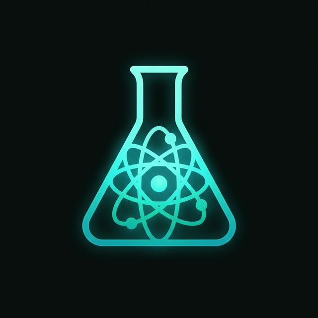

<div align="center">
  
  <h1>Chemify</h1>
  <p><strong>Chemistry, finally made visual.</strong></p>
  
  <p>
    <a href="#features">Features</a> •
    <a href="#who-is-it-for">Who is it for?</a> •
    <a href="#getting-started">Getting Started</a>
  </p>
</div>

---

**Chemify** is a modern chemistry platform for scientists, students, and researchers to explore elements, reactions, and powerful tools. Instead of memorizing static tables and abstract equations, explore elements and reactions through intuitive visuals and real-time simulations.

## ✨ Features

🔬 **Periodic Table Explorer**
Navigate through every element with rich detail — atomic structure, electron configuration, isotopes, and real-world uses, all visualized beautifully.

🧪 **Reaction Studio**
Combine elements, balance equations, and watch reactions unfold in real time. Understand stoichiometry through intuitive, interactive simulations.

🧮 **Chemistry Tools**
Molar mass calculators, unit converters, equation balancers, and more — a complete toolkit designed to save you time in the lab or classroom.

## 🎯 Who is it for?

- 🎓 **Students:** Master the fundamentals with interactive visuals that make complex concepts click instantly. Study smarter, not harder.
- 👨‍🔬 **Researchers:** Access detailed element data, reaction pathways, and precision tools built for professional-grade exploration and analysis.
- 💡 **Curious Minds:** No lab coat required. Dive into the beauty of chemistry through playful exploration and discover what everything is made of.

## 🚀 Getting Started

Chemify is built using **React 18, TypeScript, and Vite** with a responsive botanical theme, interactive canvases, and precision chemistry simulation engines.

1. **Clone the repository:**
   ```bash
   git clone <your-repository-url>
   cd Chemify
   ```
2. **Install dependencies:**
   ```bash
   npm install
   ```
3. **Start the development server:**
   ```bash
   npm run dev
   ```
4. **Build for production:**
   ```bash
   npm run build
   ```

## 🐳 Docker Production Deployment (Ports 4326 & 5467)

Chemify comes fully containerized with a hardened multi-stage Nginx build configured to listen on **ports 4326 and 5467** simultaneously:

```bash
# Build and run container in detached mode
docker compose up -d --build

# Verify container health
curl -I http://localhost:4326/
curl -I http://localhost:5467/
curl -s http://localhost:4326/healthz
```

---

## 🛠️ Makefile Commands & Automation (chemify.solaymanbuilds.com)

A dedicated [`Makefile`](file:///wsl.localhost/Ubuntu/home/soel/Desktop/Projects/Chemify/Makefile) is provided for turnkey building, Docker container orchestration, and Nginx/SSL configuration for **`chemify.solaymanbuilds.com`**:

| Command | Description |
| :--- | :--- |
| `make docker-build` | Build production Docker image (Node 22 + Nginx Alpine) |
| `make up` | Start production container on ports **4326** & **5467** |
| `make down` | Stop running Chemify container |
| `make restart` | Restart Chemify container |
| `make logs` | Follow container logs in real time |
| `make status` | Check container health and test port probes |
| `make deploy` | Complete Docker build & launch on ports 4326 & 5467 |
| `sudo make nginx-config` | Auto-configure host Nginx reverse proxy for `chemify.solaymanbuilds.com` |
| `sudo make ssl` | Issue and activate Let's Encrypt SSL certificate via Certbot |
| `make ssl-renew` | Test SSL certificate auto-renewal (dry-run) |
| `sudo make vps-setup` | Run complete end-to-end VPS deployment script |

---

## ⚡ Single-Command VPS Setup (Host Nginx + Let's Encrypt SSL)

To deploy Chemify on your VPS for **`chemify.solaymanbuilds.com`** with automatic host Nginx reverse proxy, firewall rules, and an auto-renewing Let's Encrypt SSL certificate in **one single command**:

```bash
# Run directly inside the repository on your VPS:
sudo make vps-setup
# or:
sudo bash scripts/setup-vps.sh chemify.solaymanbuilds.com admin@solaymanbuilds.com
```

Or execute directly via `curl` on a fresh VPS terminal without cloning first:

```bash
curl -fsSL https://raw.githubusercontent.com/solacode-SC/Chemify/main/scripts/setup-vps.sh | sudo bash -s -- chemify.solaymanbuilds.com admin@solaymanbuilds.com
```

### What the Single Command Does:
1. Detects OS and installs Docker, Docker Compose, Nginx, and Certbot.
2. Builds and starts Chemify via Docker on ports **4326** & **5467**.
3. Creates a host Nginx reverse proxy routing traffic from ports `80`/`443` to the container upstream.
4. Automatically provisions a valid Let's Encrypt SSL certificate with HTTPS redirect.
5. Enables a systemd timer for automatic zero-downtime SSL renewal.

---

## 📁 Project Structure

```text
Chemify/
├── index.html            # Vite HTML entry point
├── package.json          # Project scripts and dependencies
├── tsconfig.json         # TypeScript configuration
├── vite.config.ts        # Vite build & bundler configuration
├── src/
│   ├── main.tsx          # React application root
│   ├── App.tsx           # Main application router and view coordinator
│   ├── types/            # TypeScript interfaces (elements, reactions, tools)
│   ├── data/             # 118 elements data, atomic details, tools catalog
│   ├── utils/            # Chemistry formulas parser, equation balancer, reaction engine
│   ├── components/
│   │   ├── common/       # Navbar, Footer, HeroCanvas, AtomVisualizer
│   │   ├── home/         # Hero, About, Features, Teaser, Personas, CTA
│   │   ├── explorer/     # Periodic Table Grid, Cards View, ElementModal, ElectronShells
│   │   ├── lab/          # Reaction Studio, ReactionDiagram canvas, stoichiometric calculators
│   │   └── tools/        # 10 interactive chemistry calculators & ToolModal
│   └── styles/           # Global botanical theme, resets, typography, and animations
└── assets/               # High-res icons, anime-style personas, and artwork
```

## 📄 License
Built with curiosity. © 2025 Chemify.
